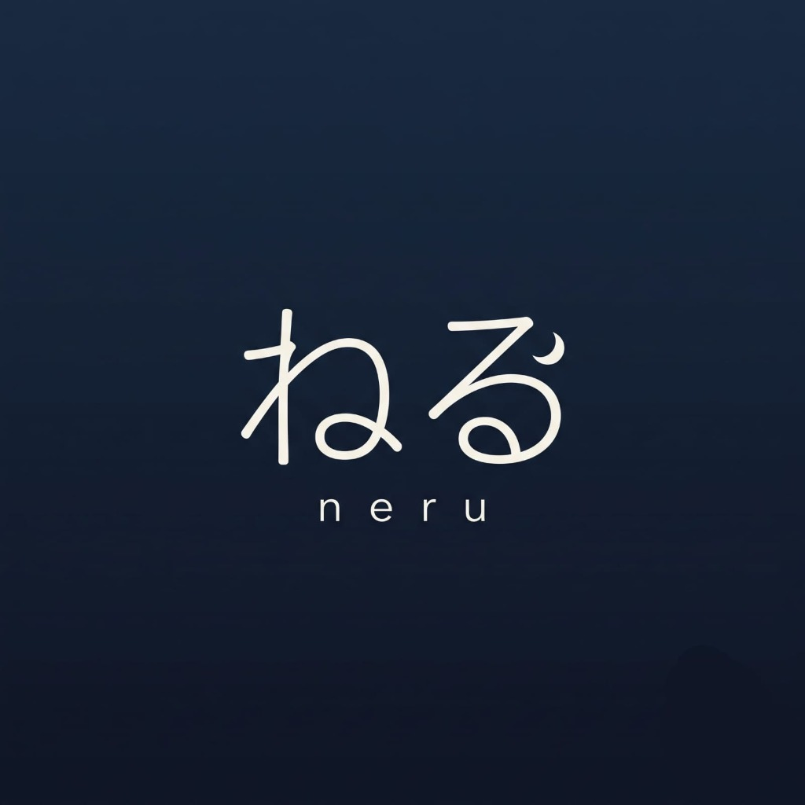

<div align="center">



# Neru (ねる)

**A privacy-focused sleep and inactivity timer for Android.**

[](https://github.com/kainotch/Neru/releases)
[](https://github.com/kainotch/Neru)
[](LICENSE)
[](https://developer.android.com)
[](#privacy-and-security)

<br/>

Neru (from Japanese ねる, "to sleep") is an open-source Android sleep timer designed to turn off your device screen and pause media playback when you fall asleep.

</div>

---

## Features

### Target App Inactivity Monitoring
- Tracks foreground activity across selected media and social apps (Spotify, YouTube, Instagram, Facebook, Netflix, and custom-selected apps).
- Automatically counts down while active apps are on screen, and pauses immediately when apps are closed or switched away.
- Supports multi-app selection and customizable app targets.

### Audio Fade-Out and Wake Recovery
- Gradually fades out system media volume during the final 30 seconds to prevent sudden silence from disrupting rest.
- If user activity is detected during the fade, volume is restored to its original level and the timer resets.

### Automated Screen Lock
- Automatically locks the device screen upon timer completion.
- Device Admin integration provides standard system-level screen locking.
- Optional Shizuku support allows soft power-button simulation to preserve biometric authentication.

### Media Playback Control
- Universal audio focus management pauses media across music players, podcast apps, video streaming services, and web browsers.

### Battery and Network Management
- Optional toggles to turn off Wi-Fi, Bluetooth, or mobile data on timer completion via Shizuku integration.

### Minimalist Dark UI
- Designed for low-light bedroom environments with an OLED dark palette.
- Accessible directly via Quick Settings tiles and home screen widgets.

---

## Privacy and Security

- **Completely Offline**: Neru does not declare the `android.permission.INTERNET` permission. It is technically incapable of connecting to the internet or transmitting data.
- **No Analytics or Telemetry**: No tracking libraries, third-party SDKs, crash loggers, or advertisements.
- **Local Storage Only**: User preferences and configurations are stored strictly on-device via Jetpack DataStore.
- **No Sensitive Permissions**: Does not request accessibility services, SMS, contacts, location, storage, camera, or microphone.

---

## Permissions Breakdown

| Permission | Category | Purpose |
| :--- | :--- | :--- |
| `FOREGROUND_SERVICE` | System | Keeps the countdown timer active in the background without being terminated by OS battery optimization. |
| `FOREGROUND_SERVICE_MEDIA_PLAYBACK` | System | Required on Android 14+ for managing media playback state. |
| `POST_NOTIFICATIONS` | Runtime | Displays the countdown status and quick controls in the notification drawer. |
| `PACKAGE_USAGE_STATS` | Usage Access | Detects when selected target apps are in the foreground. Cannot read app content, messages, or input. |
| `BIND_DEVICE_ADMIN` | Optional | Allows Neru to lock the screen when the timer completes. |
| `Shizuku` | Optional | Optional ADB-level bridge to simulate power button press and toggle network radios without root. |

---

## Architecture and Tech Stack

- **Language**: Kotlin (Coroutines, StateFlow)
- **UI Framework**: Jetpack Compose with Material 3 design components
- **Dependency Injection**: Hilt
- **Persistence**: Jetpack DataStore Preferences
- **Architecture**: Clean Architecture with MVVM / MVI unidirectional data flow
- **Inter-process Communication**: Android Services, App Widgets, AIDL (Shizuku)

---

## Project Structure

```
Neru/
├── app/               # Application entry point, navigation host, widgets, receivers
├── core/
│   ├── data/          # Data layer: repositories, DataStore models, preferences
│   └── service/       # Background execution: SleepTimerService, detectors, audio controller
├── feature/
│   └── timer/         # UI feature module: timer dial, target apps grid, settings screen
└── docs/              # Visual assets, icons, and screenshots
```

---

## Building from Source

### Prerequisites
- JDK 17 or higher (or Android Studio JBR)
- Android SDK (API 36 `compileSdk`, API 26 `minSdk`)

### Build Steps

1. Clone the repository:
   ```bash
   git clone https://github.com/kainotch/Neru.git
   cd Neru
   ```

2. Compile debug APK:
   ```bash
   ./gradlew assembleDebug
   ```

3. Compile release APK:
   ```bash
   ./gradlew assembleRelease
   ```

4. Run unit tests:
   ```bash
   ./gradlew testDebugUnitTest
   ```

Output APK files are located in `app/build/outputs/apk/`.

---

## Contributing

Contributions, bug reports, and suggestions are welcome.
1. Fork the repository.
2. Create a feature branch (`git checkout -b feature/improvement`).
3. Commit your changes (`git commit -m "Add feature"`).
4. Push to the branch (`git push origin feature/improvement`).
5. Open a Pull Request.

---

## Author

Developed by **Notch**
- GitHub: [@kainotch](https://github.com/kainotch)
- Repository: [github.com/kainotch/Neru](https://github.com/kainotch/Neru)

---

## License

This project is licensed under the GNU General Public License v3.0. See the [LICENSE](LICENSE) file for details.
